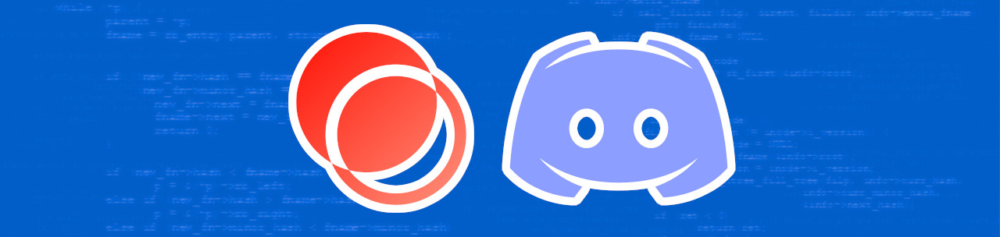
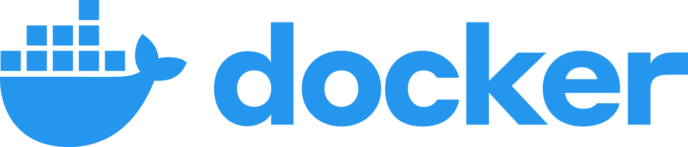

> [!WARNING]
> **Maintenance mode:** Unthread is no longer sponsoring this project. No new features are planned; future updates will focus on dependencies and remaining bug fixes. The repository is expected to be archived soon.

# Unthread Discord Bot 🤖

<p align="center">
  <a href="https://github.com/wgtechlabs/unthread-discord-bot"></a>
</p>

<p align="center">
  <strong>Connect Discord community support to Unthread.</strong><br>
  Create tickets from commands or forum posts, then keep conversations in sync.
</p>

<p align="center">
  <a href="https://github.com/wgtechlabs"></a>
  <a href="https://github.com/sponsors/wgtechlabs"></a>
  <a href="LICENSE"></a>
  <a href="https://github.com/wgtechlabs/unthread-discord-bot/releases"></a>
  <a href="https://github.com/wgtechlabs/unthread-discord-bot/stargazers"></a>
</p>

## 💎 Sponsors & Partners

<table>
  <tr>
    <td width="50%" align="center">
      <a href="https://railway.com"></a>
      <p>Cloud platform for deploying and hosting apps, databases, and infrastructure.</p>
    </td>
    <td width="50%" align="center">
      <a href="https://www.docker.com"></a>
      <p>Platform for building, sharing, and running containerized applications.</p>
    </td>
  </tr>
</table>

## ✨ Features

- Open support tickets with the `/support` command.
- Turn posts in selected Discord forum channels into Unthread tickets.
- Keep each ticket conversation organized in a Discord thread.
- Sync replies and status updates between Discord and Unthread through Redis-backed webhooks.
- Use `/ping`, `/server`, `/user`, and `/version` utility commands.

## 🚀 Getting Started

### Requirements

- A Discord application and bot token, installed in your server.
- An Unthread API key, Slack channel ID, and Slack team ID.
- PostgreSQL and two Redis connections: one for bot state and cache, and one for webhook events.
- Bun `1.4.4` for local development.
- Node.js `^22.0.0 || ^24.0.0 || ^26.0.0` when running the built application outside Docker.

### Create and invite your Discord bot

1. Create an application in the [Discord Developer Portal](https://discord.com/developers/applications) and add a bot user.
2. Enable **Message Content Intent** in the bot settings.
3. Invite the bot with View Channels, Send Messages, Send Messages in Threads, Read Message History, Create Public Threads, Create Private Threads, Manage Threads, Embed Links, and Use Slash Commands permissions. The invite URL format is:

   ```text
   https://discord.com/oauth2/authorize?client_id=YOUR_CLIENT_ID&permissions=1084479760448&integration_type=0&scope=bot+applications.commands
   ```

4. Enable Developer Mode in Discord, right-click your server, choose **Copy ID**, and use that value for `GUILD_ID`.

### Run locally

1. Clone the repository and install dependencies:

   ```bash
   git clone https://github.com/wgtechlabs/unthread-discord-bot.git
   cd unthread-discord-bot
   bun install
   ```

2. Create and configure your environment file:

   ```bash
   cp .env.example .env
   ```

   Set the required Discord, Unthread, PostgreSQL, and Redis values described under [Configuration](#-configuration).

3. Build, deploy slash commands, and start the bot:

   ```bash
   bun run start
   ```

## 📖 Usage

### Open a support ticket

In a regular server text channel, run `/support` and submit the ticket title and summary. A contact email is optional. The bot creates the Unthread ticket and a matching Discord thread. If the email is blank, the bot uses the customer's existing email or a generated `@discord.invalid` address.

`/support` does not work inside threads or in channels configured for automatic forum ticket creation.

### Create tickets from forum posts

Add Discord forum channel IDs to `FORUM_CHANNEL_IDS`. New posts in those channels create tickets and matching Discord threads; replies are synchronized with Unthread.

### Utility commands

- `/ping` shows API latency and WebSocket heartbeat.
- `/server` shows server information.
- `/user` shows user information.
- `/version` shows the running bot version.

## ⚙️ Configuration

Copy `.env.example` to `.env` and set the required values.

| Variable | Purpose |
| --- | --- |
| `DISCORD_BOT_TOKEN` | Discord bot token. |
| `CLIENT_ID` | Discord application ID. |
| `GUILD_ID` | Discord server ID used to deploy slash commands. |
| `UNTHREAD_API_KEY` | Unthread API authentication. |
| `UNTHREAD_SLACK_CHANNEL_ID` | Slack channel used by Unthread for ticket routing. |
| `SLACK_TEAM_ID` | Slack workspace ID required by startup validation. |
| `POSTGRES_URL` | PostgreSQL connection string. |
| `PLATFORM_REDIS_URL` | Redis connection for bot state and cache. |
| `WEBHOOK_REDIS_URL` | Redis connection for the webhook event queue. |

The following settings are optional or apply when running the included webhook server:

| Variable | Purpose |
| --- | --- |
| `UNTHREAD_WEBHOOK_SECRET` | Secret used by the webhook server to validate Unthread webhooks. |
| `FORUM_CHANNEL_IDS` | Comma-separated Discord forum channel IDs for automatic ticket creation. |
| `NODE_ENV` | Set to `development` for more detailed logs. |
| `PORT` | Webhook server port; defaults to `3000`. |
| `UNTHREAD_HTTP_TIMEOUT_MS` | Unthread API request timeout in milliseconds; defaults to `10000`. |
| `WEBHOOK_POLL_INTERVAL` | Redis polling interval in milliseconds; defaults to `5000`. |
| `DATABASE_SSL_VALIDATE` | Controls PostgreSQL SSL validation behavior. |
| `DATABASE_SSL_CA` | Optional CA certificate for PostgreSQL SSL. |
| `DUMMY_EMAIL_DOMAIN` | Fallback email domain for Discord users without an email. |

## 🚢 Deployment

### Railway

[](https://railway.com/template/nVHIjj?referralCode=dTwT-i)

Use the [Railway template](https://railway.com/template/nVHIjj?referralCode=dTwT-i) for a hosted setup.

### Docker Compose

The included `docker-compose.yml` starts the Discord bot, webhook server, PostgreSQL, and Redis services.

```bash
cp .env.example .env
# Set the required environment values in .env
docker-compose up -d
```

Inspect service logs with `docker-compose logs -f server` and `docker-compose logs -f webhook-server`. Deploy slash commands after configuring the bot:

```bash
docker-compose exec server node dist/deploy_commands.js
```

Build Flow publishes images to Docker Hub (`wgtechlabs/unthread-discord-bot`) and GitHub Container Registry (`ghcr.io/wgtechlabs/unthread-discord-bot`):

- `latest`, `<version>`, `<major>.<minor>`, and `<major>` are published when a GitHub release is published.
- `staging` and `staging-<sha>` track `main`.
- `dev` and `dev-<sha>` track `dev`.

Use `latest` or a version tag for stable deployments. Use `staging` or a SHA-pinned staging tag to follow `main` between releases.

### Webhook URL

The Discord bot does not expose an HTTP webhook endpoint. The included webhook server receives Unthread events and writes them to Redis; the bot consumes them from the webhook queue. Outside Docker Compose, point `REDIS_URL` on the webhook server and `WEBHOOK_REDIS_URL` on this bot to the same Redis instance.

Configure Unthread to send webhooks to:

```text
https://YOUR_PUBLIC_URL/webhook/unthread
```

For local development, expose the webhook server with a tool such as VS Code port forwarding or ngrok.

## 📚 Documentation

- [Environment template](.env.example)
- [Contributing guide](CONTRIBUTING.md)
- [Security policy](SECURITY.md)
- [Code of Conduct](CODE_OF_CONDUCT.md)

## 🛠️ Development

Run the bot with automatic reload using `bun dev`. Common validation and maintenance commands are:

```bash
bun run lint
bun run type-check
bun run build
bun run test
bun run test:coverage
bun run test:integration
bun run test:all
```

Other project commands include `bun run deploycommand`, `bun run cmd:deploy`, `bun run cmd:reset`, `bun run docker:build`, `bun run docker:run`, and `bun run sbom:generate`.

## 🤝 Contributing

Contributions are welcome. Read [CONTRIBUTING.md](CONTRIBUTING.md) and the [Code of Conduct](CODE_OF_CONDUCT.md) first. Create work branches from `dev` and target pull requests at `dev`.

## 🐛 Issues & Support

- Search [existing issues](https://github.com/wgtechlabs/unthread-discord-bot/issues) before [reporting a bug](https://github.com/wgtechlabs/unthread-discord-bot/issues/new/choose).
- Ask questions in the [GitHub Discussions help category](https://github.com/wgtechlabs/unthread-discord-bot/discussions/categories/help-support).
- Report vulnerabilities privately using the instructions in [SECURITY.md](SECURITY.md).

### Troubleshooting

- **Slash commands do not appear:** check `CLIENT_ID`, `GUILD_ID`, and `DISCORD_BOT_TOKEN`, then run `bun run deploycommand`.
- **`/support` fails:** use a regular server text channel and confirm the bot can create and manage threads there.
- **Forum posts do not create tickets:** check that `FORUM_CHANNEL_IDS` contains only forum channel IDs and that the bot has permission in those channels.
- **Webhook sync is not working:** make sure the webhook server is running, both services use the same Redis instance, and Unthread sends events to `/webhook/unthread`.
- **Database or Redis connection errors:** check `POSTGRES_URL`, `PLATFORM_REDIS_URL`, and `WEBHOOK_REDIS_URL`, and confirm those services are reachable.

## 💖 Support the Project

- [Star this repository](https://github.com/wgtechlabs/unthread-discord-bot/stargazers).
- [Sponsor WG Tech Labs](https://github.com/sponsors/wgtechlabs).
- [Buy me a coffee](https://buymeacoffee.com/wgtechlabs).
- Deploy with the [Railway template](https://railway.com/template/nVHIjj?referralCode=dTwT-i) to support ongoing development.

## 📋 Code of Conduct

Participation follows the [Code of Conduct](CODE_OF_CONDUCT.md).

## 📄 License

Licensed under the [GNU Affero General Public License v3.0](LICENSE).

## 👥 Authors & Contributors

Created by **[Waren Gonzaga](https://github.com/warengonzaga)** under [WG Tech Labs](https://github.com/wgtechlabs), with contributions from the [community](https://github.com/wgtechlabs/unthread-discord-bot/graphs/contributors).

[](https://github.com/wgtechlabs/unthread-discord-bot/graphs/contributors)

---

💻 with ❤️ by [Waren Gonzaga](https://warengonzaga.com) under [WG Technology Labs](https://wgtechlabs.com), and [Him](https://www.youtube.com/watch?v=HHrxS4diLew&t=44s) 🙏
